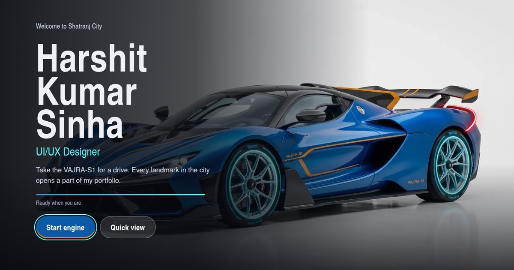

# Shatranj City: VS Code project

A portfolio you can drive. Take the **VAJRA-S1** through Shatranj City, an Indian-inspired open world built in raw WebGL 2, and pull up at each landmark to open part of the portfolio of **Harshit Kumar Sinha, UI/UX Designer**.



This folder is set up to be opened in **Visual Studio Code**: press **F5** and the game opens in your browser with live reload and working breakpoints. There are no packages to install.

---

## Quick start

1. Install [VS Code](https://code.visualstudio.com/) and [Node.js](https://nodejs.org/) 18 or newer (the LTS version is fine).
2. Unzip, then **File → Open Folder…** and choose the `shatranj-city` folder. Accept the prompt to install the recommended extensions (EditorConfig and Live Server, both optional).
3. Press **F5** and pick **Play in Chrome (dev server)**. The dev server starts, Chrome opens at `http://localhost:5173`, and the game loads.

No Chrome? Choose **Play in Edge**, or run `npm start` in the VS Code terminal (**Terminal → New Terminal**) and open <http://localhost:5173> in any browser.

Now edit any file in `src/` and save. The page reloads by itself.

> **No Node.js?** You can still view the game: double-click `index.html`, or right-click it in VS Code and choose **Open with Live Server**. Python works for rebuilding too: `python build.py`.

## What you can do from VS Code

| How | What it does |
|---|---|
| **F5** | Starts the dev server and opens the game in Chrome or Edge with the debugger attached |
| **Ctrl+Shift+B** (⌘⇧B on Mac) | Runs **Build site**: writes the self-contained `index.html` |
| **Terminal → Run Task…** | **Dev server**, **Build site**, **Check syntax**, **Build site (Python)** |
| `npm start` | Same dev server, from a terminal |
| `npm run build` | Same as Build site |
| `npm run check` | Checks all JavaScript in `src/` for syntax errors, without building |
| `npm run build:py` | The Python build, for machines with Python but no Node |

### The dev server (`dev.mjs`)

- **Live reload.** Saving a file in `src/`, or swapping an image in `assets/images/`, reloads every open tab.
- **Real files for debugging.** The page loads `src/*.js` as separate files, so the browser console shows `physics.js:212` instead of one giant script. Click in the gutter of any `src/*.js` file in VS Code to set a breakpoint, then press F5.
- **Syntax errors show on the page.** A typo shows the file name and line number on screen instead of a blank game, and the page reloads when you fix it.
- **Test on your phone.** The terminal prints an address like `http://192.168.x.x:5173`. Open it on a phone connected to the same Wi-Fi to try the touch controls. Your firewall may ask permission the first time. To keep the server to this computer only, run `node dev.mjs --host 127.0.0.1`.
- **Other options.** `node dev.mjs --port 3000` changes the port (also update the URL in `.vscode/launch.json`), and `node dev.mjs --bundle` serves the single-file bundle exactly as you deploy it. With npm, add `--` first: `npm start -- --port 3000`. The same flags work on Windows, Mac and Linux.

The dev server (separate files), its `--bundle` mode and the built `index.html` give identical physics results, so what you debug is what you ship.

### Handy things to type in the browser console

`GAME` (car, camera, phase, settings), `W` (the world: roads, buildings, landmarks), `PORTFOLIO` (your content), `TRAFFIC`, and `__game.GAME.simulate(5)` to advance the simulation five seconds. For example, `GAME.teleport(0, -100, 0)` puts the car on the Old City street.

## What's inside

- **The city.** The Old City with havelis and the Darwaza gate, Chandni Bazaar, the temple complex, the railway junction with moving trains, the Cyber-Chowk neon district, the business district and three bridges including the cable-stayed Vajra Setu.
- **Five landmarks, five sections.** About me, Skills, Case studies, Resume and Contact. There's also a plain-page **Quick view** for visitors in a hurry.
- **Real driving physics.** Tyre grip, weight transfer, a 6-speed gearbox, ABS, stability control, a drift-capable handbrake and an instant brake. Hitting walls at an angle spins the car.
- **A physical world.** Traffic you can shunt, cones and crates that tumble, lamp posts that snap, solid trees, and level crossings that stop traffic for trains.
- **Working lights.** Headlights that light the road, brake, reversing and tail lamps, indicators that switch themselves off, hazards, and a horn.
- **Time of day.** Golden hour switches to neon night automatically in Cyber-Chowk. Midday and night are available in Settings.
- **Every device.** Keyboard and mouse, touch (joystick or arrows) and game controllers, on desktop, tablet and phone.
- **Settings.** Five camera views, full screen, and choices for graphics quality, steering sensitivity, brake pedal feel, sound, minimap and reduced motion.
- **Fallback.** Browsers without WebGL 2 get the Quick view instead.


## Controls

| Action | Keyboard | Touch | Controller |
|---|---|---|---|
| Drive / brake, then reverse | W / S or ↑ / ↓ | Drive / Brake | RT / LT |
| Steer | A / D or ← / → | Joystick or arrows | Left stick |
| Handbrake (stop; steer to drift) | Space | Hand brake | X / Square |
| Instant brake | B (hold) | Stop (red) | B / Circle (hold) |
| Boost | Shift | Boost | RB |
| Enter a landmark | E or Enter | Enter | A / Cross |
| Headlights | L | Headlight button | D-pad up |
| Indicators | Z / X | Arrow buttons | L3 / R3 |
| Horn | H (hold) | Horn button | LB |
| Camera | C, mouse drag, wheel | Camera button, drag, pinch | Y / Triangle |
| City map | M | Map button | View / Select |
| Settings | Settings button | Settings button | Start / Options |
| Full screen | F | Full-screen button | |
| All controls | ? | Settings → Controls | |

## Make it yours

All portfolio text lives in one place: **`src/content.js`**, in the `PORTFOLIO` object. Every panel, hologram, departure board and the Quick view read from it. Replace everything in `[square brackets]`:

- `about.facts`: your city
- `skills`: your skill levels, 1–5 (the current numbers are placeholders)
- `caseStudies`: durations and outcomes for WallVista, plus case studies 2 and 3. WallVista's full case study lives in `case-studies/wallvista/` and is included in output from either build script.
- `resume.experience`, `resume.education` and `resume.pdfUrl`: link your PDF, for example by putting it in `assets/resume.pdf` and setting `pdfUrl: 'assets/resume.pdf'`
- `contact.email` and `contact.links`: LinkedIn, Behance, Dribbble and GitHub

Save, and the dev server reloads. When you're happy, run **Build site** (Ctrl+Shift+B) to refresh `index.html`.

**Share previews.** Social sites need an absolute image URL. After you've deployed, change `og:image` in `src/template.html` to your full address, for example `https://your-site.example/assets/og-image.jpg`, and rebuild.

## Project structure

```
.
├── index.html                 ← the built site: one self-contained file (generated, don't edit)
├── src/
│   ├── template.html          ← page shell: loader, HUD, panels, settings, styles
│   ├── content.js             ← PORTFOLIO: all your text and links
│   ├── engine.js              ← WebGL 2 renderer: maths, shaders, geometry, bloom
│   ├── world.js               ← the city: districts, roads, bridges, railway, signs
│   ├── game.js                ← car model, camera rigs, traffic, effects, render loop
│   ├── vehicles.js            ← traffic vehicles, VAJRA-S1 lamps, trains
│   ├── physics.js             ← vehicle dynamics, collisions, props, lamp posts
│   ├── ui.js                  ← HUD, minimap, map, panels, quick view, sound
│   ├── device.js              ← desktop / tablet / phone layouts, touch, controllers
│   └── lights.js              ← headlights, indicators, horn, steering sensitivity
├── dev.mjs                    ← dev server with live reload (Node)
├── build.mjs                  ← builds index.html (Node); build.py does the same in Python
├── package.json               ← npm scripts: start, build, check
├── jsconfig.json              ← lets VS Code jump between the src/ files (Ctrl+click, F12)
├── .vscode/                   ← tasks, F5 launch configs, settings, recommended extensions
├── .editorconfig  .gitignore
├── assets/
│   ├── images/                ← web-optimised art embedded into index.html
│   ├── source-art/            ← original full-size concept art
│   └── og-image.jpg           ← social share preview
├── media/
│   └── shatranj-city-gameplay.mp4
└── deploy/                    ← ready-made GitHub Pages and Vercel configs (see below)
```

The `src/*.js` files are not modules. They share one global scope and are joined in the order listed in `build.mjs` and `build.py` (`MODULES`), because later files extend earlier ones. Keep that order if you add a file, and add it to both build scripts and to `jsconfig.json` if it lives outside `src/`. Ctrl+click on a function name jumps to its definition in another file.

VS Code is configured not to format on save, because the source uses long compact lines on purpose. Format a selection by hand if you like.

## Deploy

Once you're happy with the content, `deploy/` holds ready-made configuration for the two most common hosts. See `deploy/README.md`.

- **GitHub Pages:** copy `deploy/github-pages/deploy.yml` to `.github/workflows/deploy.yml`, set **Settings → Pages → Source** to **GitHub Actions**, and push.
- **Vercel:** copy `deploy/vercel/vercel.json` to the project root and import the repository at vercel.com/new.
- **Anything else** (Netlify, Cloudflare Pages, your own server): run `node build.mjs --out public` and publish the `public/` folder. Or just upload `index.html` and `assets/og-image.jpg`.

## Troubleshooting

| Problem | Fix |
|---|---|
| F5 says the task failed, or `node` isn't recognised | Install Node.js 18+, then restart VS Code so it picks up the new path |
| "Port 5173 is already in use" | Stop the other process, or run `node dev.mjs --port 5174` and open that address |
| Chrome doesn't open on F5 | Pick **Play in Edge**, or open <http://localhost:5173> yourself while the **Dev server** task is running |
| The page is a black screen with an error message | That's the syntax-error page: fix the file and line shown and save |
| Breakpoints aren't hit | Use F5 (not Live Server), and set them in `src/*.js`, not in `index.html` |
| Phone can't reach the LAN address | Same Wi-Fi network? Allow Node through the firewall when asked. Some guest networks block device-to-device traffic |
| `python` not found on Windows | Use `py build.py`, or just use `node build.mjs` |

## Browser support

The game needs WebGL 2, which current Chrome, Edge, Firefox and Safari 15+ all support, on desktop and mobile. Graphics quality adapts on its own; older phones can choose Settings → Graphics → Low. Browsers without WebGL 2 automatically get the Quick view.

## Notes

- Settings such as camera, graphics and time of day are saved in the browser's local storage. Steering sensitivity deliberately starts at 100% every visit.
- The concept art in `assets/` was supplied for this project and is used for the loading screen and section panels.
- The only outside request the site makes is for Google Fonts (Teko, Rajdhani and Inter). Offline, it falls back to system fonts.
- No license file is included. Add one if you want others to reuse the code.
